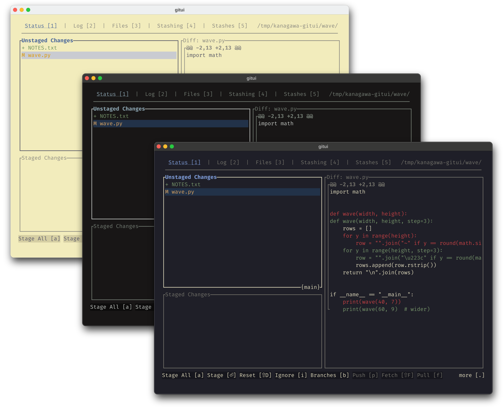
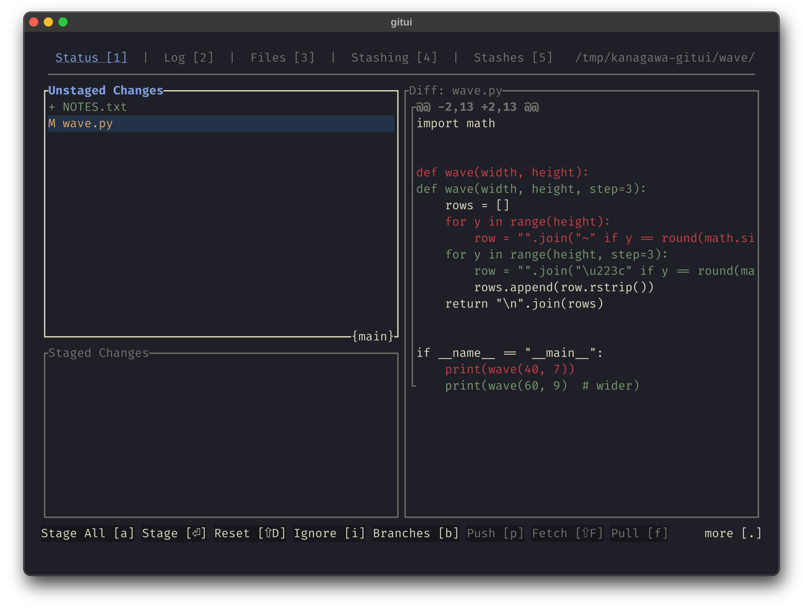
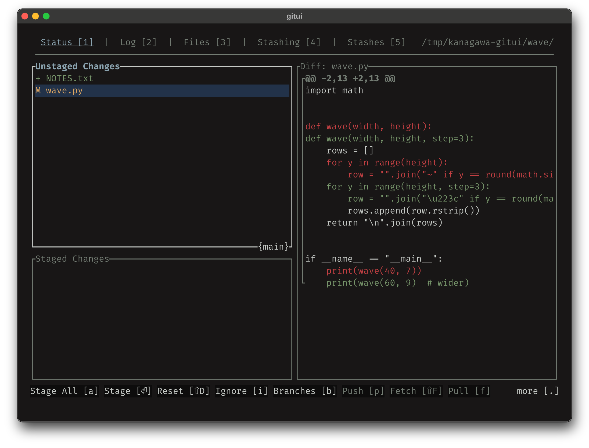
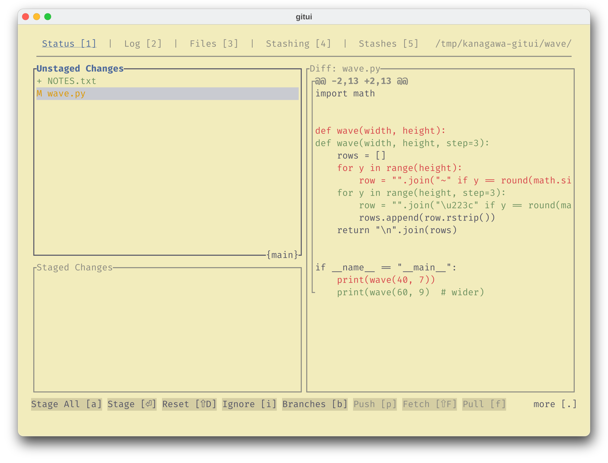

<h3>Kanagawa for <a href="https://github.com/gitui-org/gitui">gitui</a></h3>
<p>A community-maintained theme inspired by Hokusai's <em>The Great Wave off Kanagawa</em>.</p>
<p>Using the <a href="https://github.com/rebelot/kanagawa.nvim">Kanagawa palette</a> by <a href="https://github.com/rebelot">Tommaso Laurenzi (rebelot)</a>.</p>

<br clear="both">

<!-- Wave accents: carpYellow, crystalBlue, autumnRed. Lotus accents: lotusYellow, lotusBlue4, lotusRed. -->
<p align="center">
  <a href="https://github.com/kanagawa-community/gitui/stargazers">
    <picture>
      <source media="(prefers-color-scheme: dark)" srcset="https://img.shields.io/github/stars/kanagawa-community/gitui?style=for-the-badge&amp;labelColor=1F1F28&amp;color=E6C384">
      <source media="(prefers-color-scheme: light)" srcset="https://img.shields.io/github/stars/kanagawa-community/gitui?style=for-the-badge&amp;labelColor=F2ECBC&amp;color=77713F">
      
    </picture>
  </a>
  <a href="https://github.com/kanagawa-community/gitui/releases/latest">
    <picture>
      <source media="(prefers-color-scheme: dark)" srcset="https://img.shields.io/github/v/release/kanagawa-community/gitui?style=for-the-badge&amp;label=release&amp;labelColor=1F1F28&amp;color=7E9CD8">
      <source media="(prefers-color-scheme: light)" srcset="https://img.shields.io/github/v/release/kanagawa-community/gitui?style=for-the-badge&amp;label=release&amp;labelColor=F2ECBC&amp;color=4D699B">
      
    </picture>
  </a>
  <a href="https://github.com/kanagawa-community/gitui/issues">
    <picture>
      <source media="(prefers-color-scheme: dark)" srcset="https://img.shields.io/github/issues/kanagawa-community/gitui?style=for-the-badge&amp;labelColor=1F1F28&amp;color=C34043">
      <source media="(prefers-color-scheme: light)" srcset="https://img.shields.io/github/issues/kanagawa-community/gitui?style=for-the-badge&amp;labelColor=F2ECBC&amp;color=C84053">
      
    </picture>
  </a>
</p>

<br>

## Previews



<details>
<summary>🌊 Wave</summary>

</details>

<details>
<summary>🐉 Dragon</summary>

</details>

<details>
<summary>🪷 Lotus</summary>

</details>

## Requirements

- gitui 0.23 or later. Tested with gitui 0.28.1.
- A terminal with true color.
- [Kanagawa for bat](https://github.com/kanagawa-community/bat), for syntax colors in the Files tab. gitui reads `.tmTheme` files, and bat provides them.

## Installation

Clone the repository and run `./install.sh`. It installs the three themes into
`~/.config/gitui`, and copies the matching syntax themes from
`~/.config/bat/themes`. Install Kanagawa for bat first. `./install.sh` installs all
three variants, or only the ones you name, for example `./install.sh dragon lotus`.
`./uninstall.sh` takes the same names and removes them.

## Usage

Start gitui with a variant:

```sh
gitui -t kanagawa-wave.ron
```

To use a variant every time, copy it to `~/.config/gitui/theme.ron`:

```sh
cp ~/.config/gitui/kanagawa-wave.ron ~/.config/gitui/theme.ron
```

gitui does not set a background color. The terminal background shows, so use a
terminal with the same variant, for example from the
[Kanagawa terminal ports](https://github.com/kanagawa-community).

## Palette

Every color comes from the shared
[palette](https://github.com/kanagawa-community/.github/blob/main/docs/PALETTE.md),
picked by role, so each variant uses its own value for the same role.

| gitui field                                            | Palette role     |
| ------------------------------------------------------ | ---------------- |
| `selection_bg`, `push_gauge_bg`                        | `ui.bg_visual`   |
| `selection_fg`, `command_fg`                           | `ui.fg`          |
| `cmdbar_bg`                                            | `ui.bg_m3`       |
| `disabled_fg`                                          | `syn.comment`    |
| `selected_tab`, `block_title_focused`, `push_gauge_fg` | `syn.fun`        |
| `diff_line_add`, `diff_file_added`                     | `vcs.added`      |
| `diff_line_delete`, `diff_file_removed`                | `vcs.removed`    |
| `diff_file_modified`                                   | `vcs.changed`    |
| `diff_file_moved`, `commit_hash`                       | `syn.keyword`    |
| `commit_time`                                          | `syn.special1`   |
| `commit_author`                                        | `syn.string`     |
| `branch_fg`                                            | `syn.identifier` |
| `tag_fg`                                               | `syn.constant`   |
| `danger_fg`                                            | `diag.error`     |

`use_selection_fg` is off, so a selected line keeps its own color.
`scripts/generate.py` lists every field.

## Accessibility

Contrast ratios against `ui.bg` were computed for each foreground. In Wave and
Dragon, every pair is 3.2:1 or higher, and most are above 4.5:1. In Lotus, the
palette roles for modified files (`vcs.changed`, 2.0:1), commit time (`syn.special1`,
2.7:1), and the muted text (`syn.comment`, 2.9:1) stay below 3:1. The port keeps
the roles, as the style guide says, and does not claim WCAG conformance.

## Issues and contributions

Report bugs and request changes in this port's
[issue tracker](https://github.com/kanagawa-community/gitui/issues). Contributions are welcome.

See [CONTRIBUTING.md](CONTRIBUTING.md) before opening a pull request.

## License

MIT. See [LICENSE](LICENSE).
